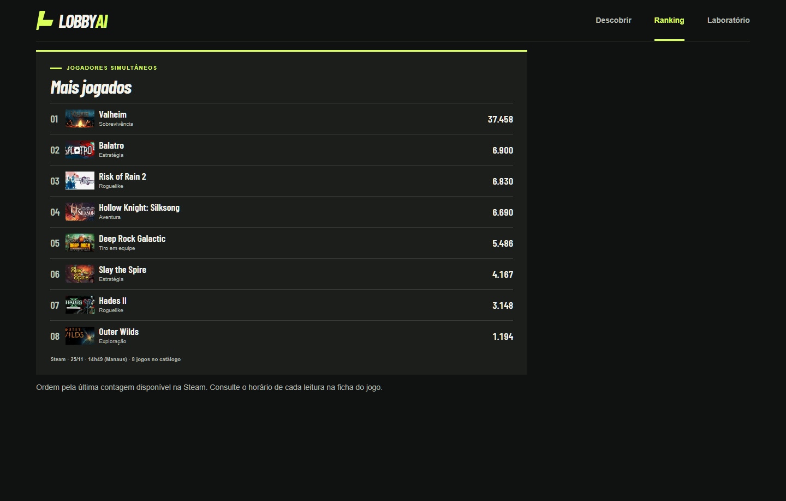
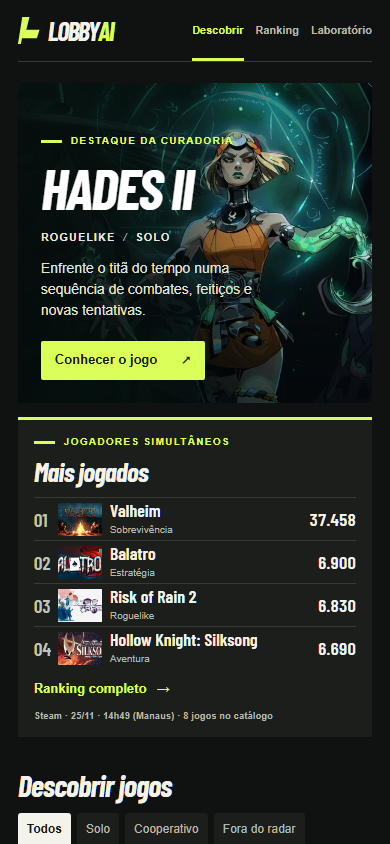

# LobbyAI

**Jackson Marques de Souza · ML Challenge · 25 de novembro de 2026**

O LobbyAI ajuda a escolher um jogo de PC para experimentar. A vitrine reúne indies, demos, jogos completos grátis e opções cooperativas da Steam. Dá para começar pelo número de jogadores, pelo voto da comunidade ou pelo tipo de experiência que você quer jogar.

[Abrir o LobbyAI online](https://nvhf4apw7m5d9xzzdmagik.streamlit.app/) · [Uso de IA com Codex](#uso-de-ia)


## Como usar

- **Descobrir** abre quatro coleções e um radar de demos indie consultado na Steam. As sugestões de cada coleção variam por dia. Use **Atualizar catálogo da Steam** para buscar novas demos e atualizar os dados pela própria tela. Em **Explorar**, combine filtros como **Grátis + Co-op online** ou **Indie + Demo**, ou use **Surpreenda-me** dentro da seleção. Cada ficha permite continuar explorando outros jogos.
- **Demos** abrem a página da demonstração na Steam; os modos da ficha são os do jogo completo. **Grátis** identifica o jogo completo que a loja informa como gratuito.
- **Ranking** ordena o catálogo pela quantidade de pessoas jogando simultaneamente na última consulta. A ficha de cada jogo mostra o horário da leitura, as avaliações acumuladas e os links da Steam e da Twitch.
- **Laboratório** é a parte de aprendizado de máquina do trabalho. O modelo lê uma avaliação em português e tenta prever o voto do autor. Na aba **Teste às cegas**, é possível revelar o voto real após dar um palpite.

Os indicadores de descoberta vêm de consultas à Steam e ao SteamSpy. O modelo de texto foi treinado separadamente com avaliações rotuladas de jogadores brasileiros. O projeto ainda não possui histórico suficiente para estimar a popularidade da próxima semana. [Dados do catálogo](data/CATALOGO.md) · [Dados do treinamento](data/README.md)

## Abrir o app

No Windows, com **Python 3.13 de 64 bits** instalado, extraia o ZIP e dê dois cliques em **Abrir_LobbyAI.bat**. A primeira abertura instala as dependências. Para usar o terminal, abra-o na pasta que contém `app.py` e execute:

```powershell
py -3.13 -m venv .venv
.\.venv\Scripts\python.exe -m pip install -r requirements.txt
.\.venv\Scripts\python.exe -m streamlit run app.py
```

No Linux ou macOS com Python 3.13, use `python3.13 -m venv .venv` e substitua `.\.venv\Scripts\python.exe` por `.venv/bin/python`. O Streamlit informa o endereço local no terminal. O modelo treinado já acompanha o projeto. Depois de instalar as dependências, a análise de texto funciona offline. Para abrir os três comentários reais pela primeira vez, clique em **Teste às cegas → Carregar avaliações** com acesso à internet.

## Dados e pré-processamento do modelo

Usei o recorte de 2.000 avaliações do *Steam Brazilian Portuguese Games Reviews Dataset*. Os pesquisadores Larissa F. S. Britto e Luciano D. S. Pacífico usaram o voto da Steam para separar quem recomendou o jogo de quem votou contra. O modelo recebe só o comentário. A identificação do arquivo e o voto ficam fora das entradas. [Origem dos dados, referência e condições de uso](data/README.md)

Antes de dividir a base, o script normaliza espaços, remove links, e-mails e menções e confere duplicatas e conflitos de voto. Nesse recorte, as 2.000 linhas tinham texto e nenhuma foi excluída por duplicidade ou conflito segundo essa verificação.

### Três coisas que apareceram nos dados

1. Há 1.000 recomendações e 1.000 votos contrários. Um palpite que sempre escolhe o mesmo voto acertaria exatamente metade do teste. O equilíbrio vem da seleção feita para a pesquisa.
2. As avaliações positivas têm mediana de 351,5 palavras, contra 336 nas negativas. O comprimento sozinho ajuda pouco a distinguir os dois grupos no gráfico.
3. Nenhuma das 2.000 avaliações tem 20 palavras ou menos pela contagem usada. Se você digitar só “gostei do jogo”, o modelo dará um palpite, mas a acurácia medida no teste diz pouco sobre frases desse tamanho.


## Como comparei os modelos

Separei 1.600 avaliações para treino e 400 para teste, preservando a proporção dos votos e usando semente 42. O TF-IDF representa palavras e pares de palavras como números. Os pares permitem tratar expressões como “não gostei” juntas. Cada modelo aprende seu vocabulário apenas com a parte de treino de cada divisão.

Comparei Naive Bayes multinomial e Regressão Logística em cinco divisões do treino. O critério de escolha foi o **F1 macro**, a média do F1 dos dois votos. Assim, ambos têm o mesmo peso. Escolhi a Regressão Logística pelo F1 macro na validação (84,05% frente a 83,29% do Naive Bayes). Só então comparei os dois modelos nas mesmas 400 avaliações de teste.

| No teste | Naive Bayes | Regressão Logística |
| --- | ---: | ---: |
| Avaliações corretas | 334 de 400 | 337 de 400 |
| Acurácia | 83,50% | 84,25% |
| F1 macro | 83,50% | 84,25% |
| Precisão macro | 83,51% | 84,29% |
| Recall macro | 83,50% | 84,25% |

### Onde o modelo errou

A Regressão Logística errou 63 dos 400 votos. O erro mais comum foi interpretar uma crítica como recomendação.

- **Quando o jogador recomendou**, o modelo acertou 172 vezes e previu voto contrário em 28.
- **Quando o jogador votou contra**, o modelo acertou 165 vezes e previu uma recomendação em 35.

[Matriz de confusão completa](reports/README.md#onde-os-modelos-erraram)

Um desses erros veio de uma avaliação de *Mortal Kombat*. O jogador elogiou a nostalgia, criticou o multiplayer e votou contra. O modelo leu o comentário inteiro e previu uma recomendação. Quem olha só para a previsão perde a queixa sobre jogar online. [Análise dos resultados](reports/README.md) · [Métricas por classe dos dois modelos](reports/metricas.json)


## Reproduzir o treinamento

No mesmo ambiente Python, execute:

```powershell
.\.venv\Scripts\python.exe train.py
```

O script baixa as duas listas de comentários de uma versão fixa da fonte, verifica os arquivos, faz a análise e treina os modelos. Ele grava o classificador junto com o vocabulário em `models/lobbyai.joblib`, as métricas em `reports/metricas.json` e os dois gráficos em `reports/graficos/`. O aplicativo carrega esse modelo ao abrir.

## Limites e próxima melhoria

O teste cobre um recorte equilibrado de avaliações longas. Uma página específica da Steam pode ter outra proporção de votos. A acurácia de 84,25% se refere aos 400 comentários separados para o teste. Uma próxima etapa seria testar o modelo com avaliações curtas de outros jogos e medir quantas recomendações ele acerta nesse grupo.

## Organização do projeto

```text
LobbyAI/
├── app.py                  # Página inicial, filtros, fichas dos jogos e ranking
├── interface.css           # Estilos da interface
├── catalogo.py             # Consulta os dados dos jogos e atualiza o catálogo
├── review_lab.py           # Laboratório de avaliações em português
├── corpus.py               # Carrega e limpa os comentários da Steam
├── train.py                # Treina os modelos e gera as métricas e os gráficos
├── data/
│   ├── catalogo.json       # Última coleta de dados dos jogos
│   ├── selecao.json        # Seleção de jogos do catálogo
│   ├── CATALOGO.md         # Critérios de seleção e fontes do catálogo
│   └── README.md           # Origem e condições de uso das avaliações
├── models/
│   └── lobbyai.joblib      # Modelo treinado que o Laboratório usa nas previsões
├── reports/
│   ├── metricas.json       # Resultados dos dois classificadores
│   ├── README.md           # Análise dos resultados
│   └── graficos/
│       ├── votos.png       # Distribuição dos votos da amostra
│       └── tamanho.png     # Tamanho dos comentários por voto
├── screenshots/            # Capturas do app no computador e no celular
├── static/
│   ├── art/                # Imagens dos jogos
│   └── fonts/              # Fontes da interface
├── .streamlit/
│   └── config.toml         # Tema e configuração do Streamlit
├── requirements.txt        # Dependências do projeto
├── Abrir_LobbyAI.bat       # Inicia o app no Windows
└── README.md               # Apresentação e instruções de execução
```

## Verificação da interface

Na vitrine, os filtros mudam os jogos exibidos. Cada capa abre a ficha do título. No ranking, o maior número de jogadores ocupa a primeira posição. No laboratório, o resultado vem do classificador salvo em disco. As imagens abaixo mostram a mesma versão em desktop e celular.



<details><summary>Ver a página no celular</summary>



</details>

## Referências

| Uso no LobbyAI | Fonte |
| --- | --- |
| Comentários em português e votos dos jogadores | Larissa F. S. Britto e Luciano D. S. Pacífico, SBGames 2020. [Artigo](https://www.sbgames.org/proceedings2020/ComputacaoShort/209781.pdf) · [Recorte usado e condições de uso](data/README.md) |
| Jogadores simultâneos e listagem de demos | Valve. [Steam Web API](https://partner.steamgames.com/doc/webapi/ISteamUserStats#GetNumberOfCurrentPlayers) · [Busca de demos indie](https://store.steampowered.com/search/?category1=10&tags=492&sort_by=Released_DESC) |
| Totais de avaliações positivas e negativas por jogo | [SteamSpy API](https://steamspy.com/api.php) |
| Redação e revisão da documentação | Lauren Tan, *pstack*. [Projeto original](https://github.com/cursor/plugins/tree/41e400932eca14f289e7db717a70455256b6d388/pstack) · [technical-writing](.agents/skills/technical-writing/SKILL.md) · [unslop](.agents/skills/unslop/SKILL.md) |

## Uso de IA

Usei o OpenAI Codex como assistente na implementação, no treinamento, nos testes e na redação da documentação. As métricas apresentadas foram calculadas pela execução de `train.py` sobre as avaliações da base.
