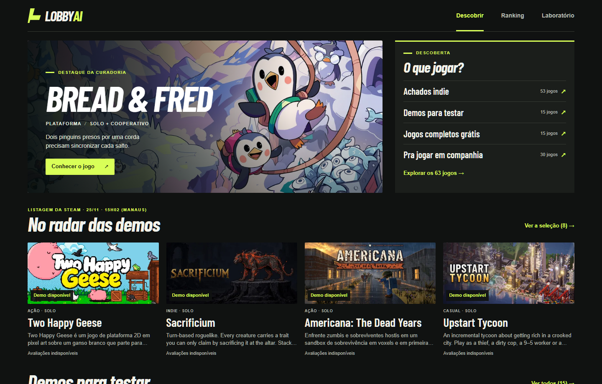

# LobbyAI

**Jackson Marques de Souza · ML Challenge · 25 de novembro de 2026**

Quero um jogo grátis pra jogar com um amigo hoje. No LobbyAI, escolho **Grátis** e **Co-op online** e vejo quais jogos do catálogo atendem aos dois critérios. Se a ideia for experimentar algo diferente, o radar reúne demos indie com um link para a demonstração na Steam.



## Escolher o que jogar

| O que você procura | Onde encontrar |
| --- | --- |
| Um jogo em dupla | Em **Pra jogar em companhia**, escolha **Co-op local** para dividir a tela ou **Co-op online** para jogar de computadores diferentes. |
| Uma demo para experimentar | Em **No radar das demos**, abra a ficha de um jogo e selecione **Abrir demo na Steam**. Os modos de jogo informados na ficha valem para a versão completa. |
| Um indie com menos gente jogando | Combine **Indie** e **Fora do radar**. Entre os jogos com menor atividade no catálogo, o app mostra primeiro os que têm maior proporção de avaliações positivas. |
| Saber o que está sendo jogado | O **Ranking** compara o número de jogadores simultâneos na Steam na última consulta. A ficha mostra o horário da leitura. |

Use **Atualizar catálogo da Steam** para consultar outras demos e atualizar os indicadores. O catálogo salvo permite explorar a última coleta ao abrir o app. [Como os jogos entram no catálogo](data/CATALOGO.md)

## Rodar no computador

Com Python 3.13 de 64 bits instalado no Windows, abra `Abrir_LobbyAI.bat`. Para iniciar pelo PowerShell, execute os comandos na pasta do projeto:

```powershell
py -3.13 -m venv .venv
.\.venv\Scripts\python.exe -m pip install -r requirements.txt
.\.venv\Scripts\python.exe -m streamlit run app.py
```

No Linux ou macOS:

```sh
python3.13 -m venv .venv
.venv/bin/python -m pip install -r requirements.txt
.venv/bin/python -m streamlit run app.py
```

Abra o endereço local que o Streamlit exibir no terminal. O repositório já inclui o modelo treinado.

## Dá para prever o voto pelo comentário?

No **Laboratório**, o modelo lê uma avaliação em português e estima se o jogador recomendou o jogo. Um dos erros no teste veio de uma avaliação de Mortal Kombat. O jogador elogiou a nostalgia, criticou o modo multiplayer e votou contra. O modelo previu uma recomendação.

O treino usou 1.600 avaliações. A Regressão Logística teve o maior F1 macro na validação cruzada e foi escolhida antes da avaliação final. Os dois algoritmos receberam as mesmas 400 avaliações de teste.

| Modelo | F1 macro na validação | Acertos no teste | Acurácia no teste |
| --- | ---: | ---: | ---: |
| Naive Bayes multinomial | 83,29% | 334 de 400 | 83,50% |
| Regressão Logística | 84,05% | 337 de 400 | 84,25% |

O modelo prevê o voto de quem escreveu. Os filtros e o ranking usam os dados do catálogo. [Análise dos comentários, gráficos e reprodução do treino](reports/README.md)

## Referências

| Uso no LobbyAI | Fonte |
| --- | --- |
| Comentários em português e votos dos jogadores | Larissa F. S. Britto e Luciano D. S. Pacífico, SBGames 2020. [Artigo](https://www.sbgames.org/proceedings2020/ComputacaoShort/209781.pdf) · [Recorte usado e condições de uso](data/README.md) |
| Jogadores simultâneos e listagem de demos | Valve. [Steam Web API](https://partner.steamgames.com/doc/webapi/ISteamUserStats#GetNumberOfCurrentPlayers) · [Busca de demos indie](https://store.steampowered.com/search/?category1=10&tags=492&sort_by=Released_DESC) |
| Totais de avaliações positivas e negativas por jogo | [SteamSpy API](https://steamspy.com/api.php) |
| Redação e revisão da documentação | Lauren Tan, *pstack*. [Projeto original](https://github.com/cursor/plugins/tree/41e400932eca14f289e7db717a70455256b6d388/pstack) · [technical-writing](.agents/skills/technical-writing/SKILL.md) · [unslop](.agents/skills/unslop/SKILL.md) |

O Codex auxiliou na implementação, no treinamento, nos testes e na documentação. O script `train.py` calculou os resultados sobre o corpus de avaliações da Steam.
