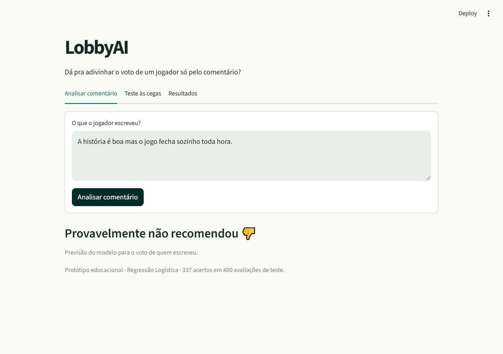
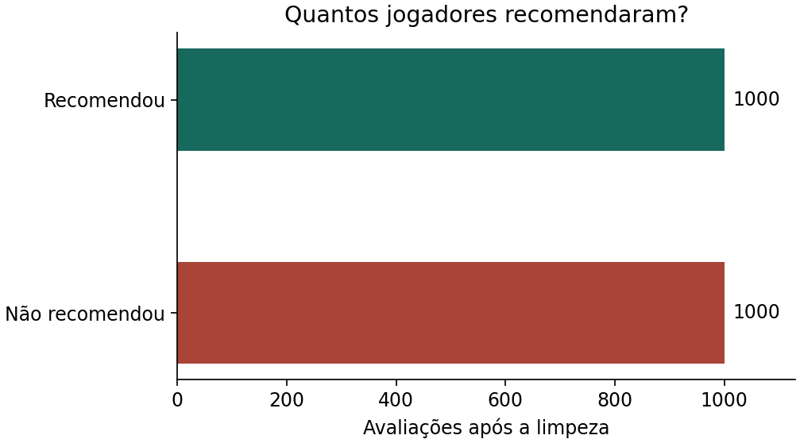
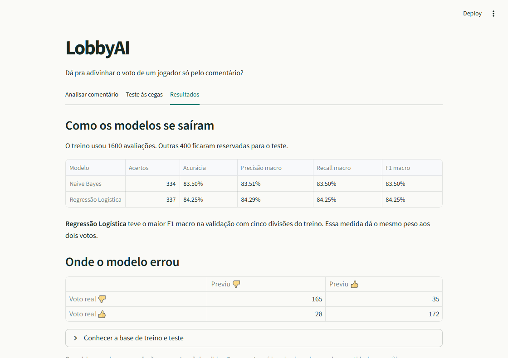

# LobbyAI

**Jackson Marques de Souza · ML Challenge · 25 de novembro de 2026**

Será que dá para adivinhar o joinha de um jogador só pelo que ele escreveu? O LobbyAI lê uma avaliação em português da Steam e tenta prever o voto do autor. O jogador pode elogiar a campanha e reclamar do multiplayer no mesmo texto. Esse tipo de comentário torna a resposta menos óbvia.



## Abrir o app

No Windows, com **Python 3.13 de 64 bits** instalado, extraia o ZIP e dê dois cliques em **Abrir_LobbyAI.bat**. A primeira abertura instala as dependências. Para usar o terminal, abra-o na pasta que contém `app.py` e execute:

```powershell
py -3.13 -m venv .venv
.\.venv\Scripts\python.exe -m pip install -r requirements.txt
.\.venv\Scripts\python.exe -m streamlit run app.py
```

No Linux ou macOS com Python 3.13, use `python3.13 -m venv .venv` e substitua `.\.venv\Scripts\python.exe` por `.venv/bin/python`. O Streamlit informa o endereço local no terminal. O modelo treinado já acompanha o projeto. Depois de instalar as dependências, a análise de texto funciona offline. Para abrir os três comentários reais pela primeira vez, clique em **Teste às cegas → Carregar avaliações** com acesso à internet.

## O que entrou no treino

Usei o recorte de 2.000 avaliações do *Steam Brazilian Portuguese Games Reviews Dataset*. Os pesquisadores Larissa F. S. Britto e Luciano D. S. Pacífico usaram o voto da Steam para separar quem recomendou o jogo de quem votou contra. O modelo recebe só o comentário. A identificação do arquivo e o voto ficam fora das entradas. [Origem dos dados, referência e condições de uso](data/README.md)

Antes de dividir a base, o script normaliza espaços, remove links, e-mails e menções e confere duplicatas e conflitos de voto. Nesse recorte, as 2.000 linhas tinham texto e nenhuma foi excluída por duplicidade ou conflito segundo essa verificação.

### Três coisas que apareceram nos dados

1. Há 1.000 recomendações e 1.000 votos contrários. Um palpite que sempre escolhe o mesmo voto acertaria exatamente metade do teste. O equilíbrio vem da seleção feita para a pesquisa.
2. As avaliações positivas têm mediana de 351,5 palavras, contra 336 nas negativas. O comprimento sozinho ajuda pouco a distinguir os dois grupos no gráfico.
3. Nenhuma das 2.000 avaliações tem 20 palavras ou menos pela contagem usada. Isso importa na demonstração: uma frase digitada em sala é bem mais curta do que os textos usados para medir a acurácia.




## Como comparei os modelos

Separei 1.600 avaliações para treino e 400 para teste, preservando a proporção dos votos e usando semente 42. O TF-IDF representa palavras e pares de palavras como números. Os pares permitem tratar expressões como “não gostei” juntas. Cada modelo aprende seu vocabulário apenas com a parte de treino de cada divisão.

Comparei Naive Bayes multinomial e Regressão Logística em cinco divisões do treino. O critério de escolha foi o **F1 macro**, a média do F1 dos dois votos. Assim, ambos têm o mesmo peso. A Regressão Logística ficou com 84,05% na validação, contra 83,29% do Naive Bayes. Depois dessa escolha, avaliei os dois modelos no mesmo teste reservado.

| Modelo | F1 macro na validação | Acertos no teste | Acurácia | Precisão macro | Recall macro | F1 macro no teste |
| --- | ---: | ---: | ---: | ---: | ---: | ---: |
| Naive Bayes | 83,29% | 334/400 | 83,50% | 83,51% | 83,50% | 83,50% |
| Regressão Logística | 84,05% | 337/400 | 84,25% | 84,29% | 84,25% | 84,25% |

No teste da Regressão Logística, a matriz de confusão ficou assim:

| Voto do jogador | Previsão 👎 | Previsão 👍 |
| --- | ---: | ---: |
| 👎 Não recomendou | 165 | 35 |
| 👍 Recomendou | 28 | 172 |

Em 35 casos o modelo tratou uma crítica como recomendação. Em outros 28, perdeu uma recomendação real. Para quem analisa o que os jogadores pensam de um lançamento, o primeiro erro pode esconder reclamações. As métricas por classe e as matrizes dos **dois** modelos estão no [relatório de avaliação](reports/metricas.json).



## Reproduzir o treinamento

No mesmo ambiente Python, execute:

```powershell
.\.venv\Scripts\python.exe train.py
```

O script baixa as duas listas de comentários de uma versão fixa da fonte, verifica os arquivos, faz a análise e treina os modelos. Ele grava o classificador junto com o vocabulário em `models/lobbyai.joblib`, as métricas em `reports/metricas.json` e os dois gráficos em `reports/graficos/`. O aplicativo carrega esse modelo ao abrir.

## Demonstração em sala

Abra **Teste às cegas**, leia um dos comentários e peça o palpite da turma. Ao clicar em **Revelar previsão e voto**, o aplicativo processa aquele texto e mostra o voto real ao lado do resultado da previsão. Os três casos foram escolhidos depois da avaliação para mostrar dois acertos e um erro.

| Caso | O que o jogador comenta | Voto real | LobbyAI |
| --- | --- | --- | --- |
| 1 | O desafio de cortar árvores em Timberman | Recomendou | Recomendou |
| 2 | Um jogo que piorou com as atualizações | Não recomendou | Não recomendou |
| 3 | A nostalgia de Mortal Kombat e os problemas do multiplayer | Não recomendou | Recomendou |

O caso 3 rende uma pergunta para a turma: um jogador pode elogiar parte do jogo e mesmo assim votar contra? Aqui, foi exatamente o que aconteceu. A previsão para esse caso foi feita com o texto integral.

## Limites e próxima melhoria

O teste cobre um recorte equilibrado de avaliações longas. Uma página específica da Steam pode ter outra proporção de votos. A acurácia de 84,25% se refere aos 400 comentários separados para o teste. Para medir melhor o uso em sala, uma próxima etapa seria coletar avaliações curtas de outros jogos e calcular o resultado nelas, separadamente.

## Uso de IA

O Codex auxiliou na implementação, no treinamento, nos testes e na redação da documentação. As métricas apresentadas foram calculadas pela execução de `train.py` sobre as avaliações da base.
