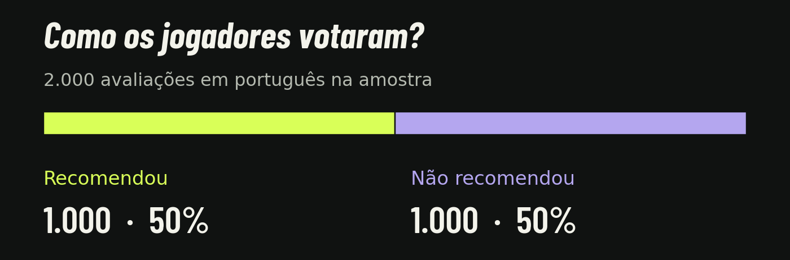
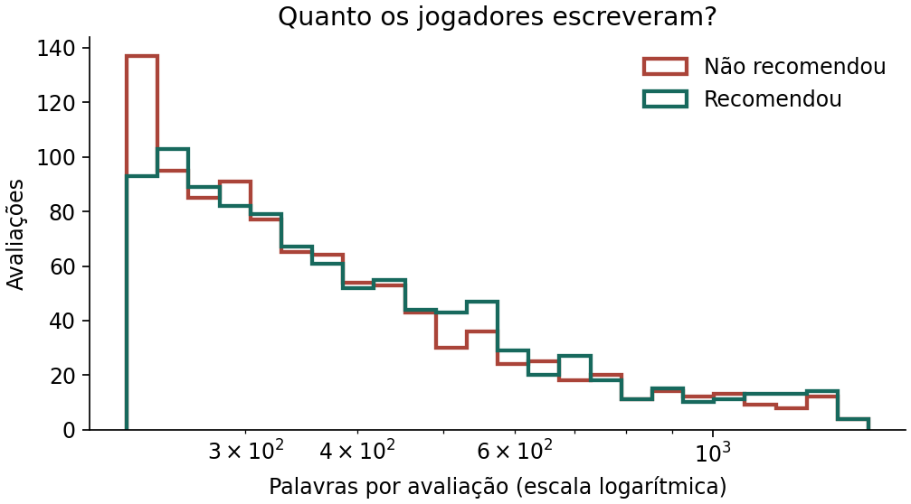

# O que as avaliações da Steam mostram

O corpus tem 1.000 votos a favor e 1.000 contra. O equilíbrio vem do recorte da pesquisa. Na página de um jogo específico, a proporção pode ser bem diferente. [Origem das avaliações](../data/README.md)



Os jogadores que recomendaram escreveram uma mediana de 351,5 palavras. Para quem votou contra, a mediana foi de 336. Há bastante sobreposição entre os dois grupos. Nenhum dos 2.000 textos tem 20 palavras ou menos. A acurácia medida aqui, portanto, diz pouco sobre o que esperar de uma frase curta digitada no app.



## Como o texto vira uma previsão

O script normaliza os espaços, remove links, e-mails e menções e procura textos repetidos ou com votos conflitantes. As 2.000 avaliações passaram por essas verificações. A divisão estratificada, com semente 42, reservou 400 para o teste.

O TF-IDF atribui pesos a palavras e pares de palavras. Isso permite representar uma expressão como “não gostei”. Em cada uma das cinco divisões da validação, o vocabulário foi ajustado apenas com os comentários usados no treino daquela divisão. O identificador e o voto real ficaram fora das entradas.

## Onde os modelos erraram

| Modelo | Precisão macro | Recall macro | F1 macro no teste |
| --- | ---: | ---: | ---: |
| Naive Bayes multinomial | 83,51% | 83,50% | 83,50% |
| Regressão Logística | 84,29% | 84,25% | 84,25% |

A Regressão Logística interpretou 35 votos contrários como recomendações. Também deixou de identificar 28 recomendações. A matriz mostra como esses 63 erros se distribuem entre os 400 comentários do teste.

| Voto do jogador | Modelo previu voto contra | Modelo previu recomendação |
| --- | ---: | ---: |
| Não recomendou | 165 | 35 |
| Recomendou | 28 | 172 |

Uma próxima avaliação pode reservar comentários curtos de outros jogos e medir os erros nesse grupo. [Métricas por classe e matrizes dos dois modelos](metricas.json)

## Reproduzir a análise

Com as dependências instaladas, execute na raiz do projeto:

```powershell
.\.venv\Scripts\python.exe train.py
```

No Linux ou macOS, use `.venv/bin/python train.py`. Na primeira execução, o script baixa a base e confere o SHA-256 dos arquivos. O treino grava a comparação em `reports/metricas.json`, os gráficos em `reports/graficos/` e o modelo com seu vocabulário em `models/lobbyai.joblib`.
